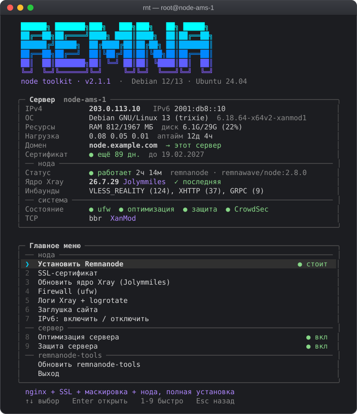

# remnanode-tools — установка и обслуживание ноды Remnawave

<p align="center"></p>

Модульный установщик ноды Remnawave с меню на стрелках: нода, SSL-сертификат с автопродлением,
кастомное ядро Xray, firewall, заглушка сайта, а также **оптимизация**, **защита** и **блок-листы** для
сервера. Debian 12 / 13, Ubuntu 24.04.

## Установка одной командой

```bash
bash <(curl -fsSL https://raw.githubusercontent.com/Rxxich/remnanode-tools/main/install.sh)
```

Под обычным пользователем:

```bash
sudo bash -c "$(curl -fsSL https://raw.githubusercontent.com/Rxxich/remnanode-tools/main/install.sh)"
```

После установки меню открывается короткой командой **`rnt`** (полное имя — `remnanode-tools`).
Скрипт лежит в `/opt/remnanode-tools`.

## Меню

| Клавиши | Что делают |
|---|---|
| `↑ ↓` (или `j k`), `Home` `End` | выбор пункта |
| `Enter`, `1–9` | открыть пункт |
| **`Esc`** (или `q`, `←`) | **назад без изменений** — из любого меню, чек-листа, поля ввода и вопроса |
| `Пробел` | отметить пункт в чек-листе |
| `← →`, `y` / `n` | ответ в вопросах «Да/Нет» |

Esc работает везде и возвращает в меню, ничего не применяя: в настройках остаётся то, что было.
Мастер установки при этом запоминает уже введённые ответы и подставит их при следующем входе, даже
после перезапуска `rnt`. В полях ввода есть курсор: `← →`, `Home` `End`,
`Backspace` `Delete`, `Ctrl+U` (стереть до курсора). Длинные ссылки прокручиваются внутри поля.

На главном экране сводка: IP, домен и срок сертификата, состояние ноды и версия ядра Xray (с проверкой
обновлений), инбаунды, состояние ufw, оптимизации, защиты и CrowdSec. Уже установленная нода
находится по имени контейнера или образу, даже если её ставил другой скрипт.

| Пункт | Что делает |
|---|---|
| Установить Remnanode | мастер: email, домен, SECRET_KEY, версия ноды, скрытный режим, заглушка, XHTTP/gRPC, опции, SSL. Перед запуском показывает сводку |
| SSL-сертификат | срок, продление, смена способа выпуска, свой сертификат, уведомления в Telegram — см. ниже |
| Ядро Xray (Jolymmiles) | установка, обновление до свежего релиза, проверка SHA-256, откат на `.prev` |
| Firewall (ufw) | SSH (**все реальные порты**, не только 22), 80, 443, порт ноды только для IP панели |
| Логи Xray + logrotate | логи на хосте, ротация с `maxsize 500M` |
| Заглушка сайта | статический шаблон с GitHub (свой репозиторий шаблонов — `TPL_REPO=owner/repo`) или docker-сервис |
| IPv6 | включить или выключить, сохраняется после перезагрузки |
| Оптимизация сервера | см. ниже |
| Защита сервера | см. ниже, там же блок-листы |
| Обновить Remnanode и nginx | скачать свежие образы и перезапустить обновлённые контейнеры. nginx обновляется всегда, нода — только если в её docker-compose тег `latest` или `dev`; закреплённая версия (например `2.8.0`) не трогается. Старые образы удаляются |
| Обновить remnanode-tools | скачать свежую версию с GitHub. Если она новее установленной, у пункта виден значок `↑` с её номером |

Команды без меню: `rnt install`, `rnt cert [status|renew|check]`, `rnt optimize [apply|status|rollback|xanmod]`,
`rnt protect [apply|status|rollback|ssh|updates|crowdsec|lists]`, `rnt status`, `rnt node-update`, `rnt update`, `rnt version`.

SECRET_KEY вставляется как есть, длина не ограничена (ключи бывают 2–3 тысячи символов). Вместо ключа
на экране счётчик символов, переносы строк из буфера обмена склеиваются, двойной Enter тоже работает.

## SSL-сертификат

Способ выбирается в мастере установки, а сменить его можно в любой момент в «SSL-сертификат →
Сменить способ». Готовый сертификат всегда лежит в `/opt/remnanode/nginx/` (`fullchain.pem`,
`privkey.key`): его используют nginx и нода.

| Способ | Как работает | Что нужно |
|---|---|---|
| **HTTP-01** (acme.sh) | проверочные файлы отдаёт nginx на порту 80 | A-запись домена на сервер, порт 80 открыт |
| **DNS API** (acme.sh) | запись `_acme-challenge` создаётся через API DNS-провайдера; можно **wildcard** `*.домен` | ключ или токен провайдера |
| TLS-ALPN-01 (acme.sh) | прежний способ: acme.sh слушает 8443 | центр сертификации проверяет порт 443, поэтому нужен проброс 443 → 8443 |
| Cloudflare через certbot | прежний способ: certbot + API-токен Cloudflare | токен Cloudflare |
| **Свой сертификат** | готовые `fullchain.pem` и `privkey.pem`, проверка перед установкой | файлы сертификата |

Центр сертификации для acme.sh — Let's Encrypt (по умолчанию) или ZeroSSL.

**DNS-провайдеры** (плагины acme.sh, имена переменных сверены с его исходниками):

| Провайдер | Что спросит |
|---|---|
| Cloudflare | API-токен (Zone → DNS → Edit), Zone ID — по желанию |
| Gcore | API-ключ |
| Bunny.net | API-ключ |
| Selectel | ID аккаунта, проект, сервисный пользователь и пароль (API v2) |
| Timeweb Cloud | API-токен |
| Reg.ru | логин и пароль API (IP сервера нужно разрешить в настройках API Reg.ru) |
| Beget | логин и пароль API |
| Yandex Cloud | ID зоны, каталога, сервисного аккаунта, ключа и сам ключ в base64 |
| Другой | любой из DNS-плагинов acme.sh: имя (`dns_hetznercloud`, `dns_dgon`…) и переменные `ИМЯ=значение` |

Ключи передаются acme.sh только через окружение (их не видно в списке процессов). acme.sh сам
сохраняет их в `~/.acme.sh/account.conf` (доступ только у root): они нужны для продления. При
повторном выпуске скрипт предложит взять уже сохранённые ключи.

**Порт 80 и продление по HTTP-01.** Порт 80 не закрывается и не освобождается на время продления.
nginx ноды сам отдаёт `/.well-known/acme-challenge/` из папки `/opt/remnanode/acme`, поэтому
продление идёт без остановки сайта и ноды. Перед каждым продлением помощник проверяет порт:

- nginx отдаёт проверочные файлы — продлеваем;
- порт 80 свободен — на время проверки поднимается временный контейнер nginx и сразу удаляется;
- порт 80 занят другим процессом — продление не начинается, причина пишется в журнал и в Telegram.

**Свой сертификат** можно загрузить на сервер (`scp fullchain.pem privkey.pem root@сервер:/etc/remnanode-tools/custom-cert/`)
или вставить текстом прямо в терминал. Перед установкой проверяется:

- оба файла — корректный PEM, ключ без пароля;
- ключ подходит к сертификату;
- сертификат выдан на домен ноды (в том числе wildcard на один уровень);
- срок не истёк; меньше 30 дней — предупреждение;
- цепочка сходится к общепризнанным корневым сертификатам. Если нет (самоподписанный, Cloudflare Origin CA,
  нет промежуточного) — предупреждение: клиенты, проверяющие сертификат, его не примут.

Свой сертификат сам не продлевается, о сроке напомнит Telegram.

**После смены способа** старое продление отключается: прежний сертификат acme.sh снимается с
продления, deploy-hook certbot удаляется. Иначе при своём продлении старый способ перезаписал бы новый
сертификат.

**Уведомления в Telegram** (по желанию): бот, ID чата (можно тему группы: `-100…:42`), прокси для
`api.telegram.org`, если он недоступен. Раз в сутки проверяется срок при любом способе выпуска: если
до конца осталось N дней (по умолчанию 14), придёт напоминание. Для HTTP-01 и DNS API сообщение
приходит и после каждого продления. Токен передаётся curl через stdin, а не в аргументах.

**Проверить автопродление** покажет cron acme.sh и способ, которым он продлевает, дату следующего
продления и состояние порта 80. Для certbot можно сделать пробный прогон `--dry-run` на тестовом CA:
сертификат при этом не меняется.

## Оптимизация

Всё пишется в собственные файлы и откатывается пунктом «Откатить оптимизацию» без перезагрузки.

- **sysctl по объёму RAM** (4 уровня: до 1 ГБ, до 2.5, до 8, больше 8 ГБ): BBR + fq, буферы сокетов,
  очереди, `somaxconn`, SYN backlog, TIME_WAIT, TCP Fast Open, MTU probing, `tcp_min_snd_mss=512`.
- **conntrack от RAM** (не больше 1/8 памяти), простаивающие established-записи живут 2 часа.
- Защита ядра: syncookies, `rp_filter=2`, без ICMP redirect и source routing.
- **Порты ноды выводятся из эфемерного диапазона**, чтобы исходящее соединение не заняло порт xray.
- `tcp_bbr` и `nf_conntrack` грузятся до sysctl на старте. Без этого ключи conntrack молча не применяются после перезагрузки.
- Лимит файловых дескрипторов 1 048 576, журнал systemd ограничен по размеру.
- **RPS** на одноочередных virtio-VPS: входящие пакеты обрабатываются всеми ядрами, а не только cpu0.
- `kernel.panic=10`: после сбоя ядра сервер сам перезагрузится, а не будет висеть.
- Своп-файл на маленьких VPS (предлагается, если RAM ≤ 2.5 ГБ и свопа нет).
- **XanMod (BBRv3)** — отдельный пункт, по желанию. Ключ репозитория проверяется по полному отпечатку.
  Перед установкой проверяются Secure Boot и место в `/boot`, после — initrd и драйвер сетевой карты.
  Штатное ядро остаётся в GRUB.

«Проверить состояние» сверяет каждый ключ с ядром и показывает, что перебил другой файл в `/etc/sysctl.d`.

## Защита

Своя таблица nftables `inet remnanode_tools`. `flush ruleset` не делается, поэтому работает рядом с ufw,
Docker и CrowdSec. **Порты закрывает ufw**, а эта таблица режет атаки на открытые порты.

- **Анти-скан**: SYN на порт, который никто не слушает. Первый раз адрес попадает в «подозрительные»,
  если продолжает — бан. Обычный клиент, ошибившийся портом, не банится.
- **Перебор SSH**: больше 10 новых подключений в минуту с адреса. Сначала лишние подключения
  отбрасываются, бан — только если перебор продолжается (за повторный SYN не банит).
- **SYN-флуд с одного IP** на открытые порты: лишнее отбрасывается без бана.
- **Пинг**: не больше 10 в секунду с адреса.
- Мусорные TCP-флаги (XMAS, NULL, SYN+FIN…) и invalid-пакеты.
- **Блок-листы** — см. следующий раздел.
- По желанию: лимит одновременных соединений с IP (по умолчанию выключен из-за CGNAT).
- **Белый список**: IP панели и ваш текущий SSH-адрес добавляются сами и обходят всё, включая блок-листы.
- **Сейфти-таймер**: после применения нужно подтвердить, что новое SSH-подключение работает.
  Без подтверждения через 2 минуты защита снимется сама.
- Список открытых портов обновляется раз в минуту: новый инбаунд из панели защищается сам. Порт
  остаётся «открытым» ещё сутки после того, как пропал, поэтому после перезагрузки клиенты не попадут
  под анти-скан, пока xray поднимается.
- Баны и статистика блок-листов переживают перезагрузку и повторное применение.

Дополнительно в меню защиты:

- **CrowdSec** из репозитория с проверкой ключа + bouncer nftables. Область «только SSH» по
  умолчанию: общий список CrowdSec на всех портах банит целые пулы мобильных операторов. Подключаются
  логи nginx-прокси с whitelist путей XHTTP/gRPC.
- **Укрепить SSH**: `LoginGraceTime 30`, `MaxStartups 10:30:60`, `MaxAuthTries 4`. Вход только по ключу —
  по желанию и только если ключ уже есть. Перед перезагрузкой sshd проверяется через `sshd -t`.
- **Автообновления безопасности**: патчи CVE ставятся сами, docker и containerd исключены, без
  автоперезагрузки, needrestart не перезапускает docker.

## Блок-листы

«Защита сервера» → «Блок-листы». С адресов из включённых списков отбрасывается всё новое: TCP, UDP, пинг.
Исходящие соединения самого сервера и уже установленные соединения не рвутся.

Встроенные списки (включить или выключить — «Какие списки блокировать»):

| id | Список | По умолчанию |
|---|---|---|
| `gov` | Госсети РФ — shadow-netlab `government_networks.list` | вкл |
| `antiscan` | Сканеры — shadow-netlab `antiscanner.list` | вкл |
| `skipa` | СКИПА — shadow-netlab `skipa.list` | вкл |
| `c24` | AS blacklist — C24Be `blacklists/blacklist.txt` | вкл |
| `cyberok` | СКИПА CyberOK — tread-lightly `skipa_cidr.txt` | вкл |
| `spamhaus` | Spamhaus DROP (IPv4 + IPv6) | вкл |
| `firehol` | FireHOL Level 1 | выкл |

- **Как часто обновлять**: каждые 1, 3, 6 (по умолчанию), 12 часов или раз в сутки. Таймер
  переписывается сразу, следующее обновление считается от последнего.
- **Свой список по ссылке**: любой https-файл с адресами по строкам (`#` — комментарий). Ссылку на файл
  в GitHub (`github.com/…/blob/…`) скрипт переведёт в raw сам и сразу проверит, сколько в ней адресов.
- **Свои адреса**: IP или подсеть, которые блокируются всегда (отдельный список «Свои адреса»).
- **Исключения**: адрес из чужого списка, который блокировать не нужно. Анти-скан и защита SSH к нему
  продолжают действовать. Белый список сильнее блок-листов и без этого.
- **Статистика** по каждому списку: сколько в нём сетей, сколько **разных адресов из него заблокировано
  за последние сутки** и сколько пакетов отброшено. Видна в «Блок-листы» и в «Состояние защиты».
  Если адрес есть в двух списках, он засчитывается первому.

Если в «Какие списки блокировать» ничего не поменять или выйти по Esc, правила не пересобираются.

Как списки проверяются при загрузке (по таймеру и по кнопке «Обновить сейчас»):

- берутся только корректные IPv4/IPv6-подсети, комментарии и мусор отбрасываются;
- частные и служебные сети (10/8, 172.16/12, 192.168/16, 100.64/10, 127/8…) вырезаются, IPv4 шире /8 не принимается;
- вложенные и дублирующиеся подсети схлопываются;
- если список не скачался, пришёл пустым или сократился больше чем в 10 раз, остаётся прежняя версия,
  а в статистике появляется предупреждение.

Списки ведут сторонние люди. Если автор (или тот, кто взломает его GitHub) добавит туда ваш адрес,
нода начнёт его резать. Поэтому IP панели и ваш SSH-адрес держите в белом списке: он проверяется раньше
блок-листов.

## Управление из консоли

Помощник `remnanode-tools-guard`, короче — через `rnt guard`:

```bash
rnt guard allow 1.2.3.4              # в белый список
rnt guard unban 1.2.3.4              # разбанить (и в CrowdSec)
rnt guard ban 1.2.3.4 7d
rnt guard bans
rnt guard status                     # счётчики отброшенных пакетов
rnt guard lists                      # статистика блок-листов
rnt guard local add 203.0.113.0/24   # свой адрес в блок
rnt guard exclude add 5.6.7.8        # исключение из блок-листов
rnt guard blocklist update           # обновить списки сейчас
```

Сертификат:

```bash
rnt cert status                      # домены, срок, способ, продление
rnt cert renew                       # продлить сейчас
rnt cert check                       # проверить автопродление
```

## Что и где лежит

| Путь | Что |
|---|---|
| `/opt/remnanode-tools` | сам скрипт, команды `/usr/local/bin/rnt` и `/usr/local/bin/remnanode-tools` |
| `/etc/remnanode-tools/config.env` | ответы мастера (права 600, значения экранированы) |
| `/opt/remnanode/nginx/fullchain.pem`, `privkey.key` | сертификат, который используют nginx и нода |
| `/opt/remnanode/acme` | проверочные файлы HTTP-01 (nginx отдаёт их на порту 80) |
| `/etc/remnanode-tools/custom-cert/` | свой сертификат (оригиналы) |
| `/usr/local/sbin/remnanode-tools-cert`, `/etc/remnanode-tools/cert.conf` | помощник сертификата и его настройки (Telegram) |
| `remnanode-tools-cert-check.timer` | ежедневная проверка срока (только при включённом Telegram) |
| `/etc/remnanode-tools/blocklists.conf` | блок-листы: `id\|on/off\|название\|ссылки` |
| `/etc/remnanode-tools/blocklist-local.txt`, `blocklist-exclude.txt` | свои адреса и исключения |
| `/var/log/remnanode-tools.log` | подробный лог всех шагов |
| `/etc/sysctl.d/99-remnanode-tools.conf` и др. `*remnanode-tools*` | оптимизация |
| `/etc/remnanode-tools/guard.nft`, `/usr/local/sbin/remnanode-tools-guard`, `remnanode-tools-guard*.service/.timer` | защита |
| `/var/lib/remnanode-tools/guard/lists/` | скачанные списки и их статус |
| `/etc/ssh/sshd_config.d/00-remnanode-tools.conf` | настройки sshd |

В скрытном режиме вместо `/opt/remnanode` — каталог с выбранным нейтральным именем.
Имя `remnanode-tools` видно в `/opt`, `/etc` и в systemd. Если это мешает, имя меняется в одном месте:
`KIT_NAME`, `KIT_CMD`, `KIT_NFT` в `lib/core.sh`.

## Структура

```
install.sh            загрузчик: скачать с GitHub → /opt/remnanode-tools → меню
remnanode-tools.sh    точка входа: меню и команды (rnt)
lib/core.sh           пути, вывод, шаги с прогрессом, конфиг, проверки, ОС и сеть
lib/ui.sh             меню на стрелках, подтверждения, поля ввода, чек-листы, панели
modules/node.sh       установка ноды: зависимости, nginx, compose
modules/certs.sh      SSL: способы выпуска, свой сертификат, продление, Telegram
modules/stub.sh       заглушка сайта
modules/xcore.sh      ядро Xray Jolymmiles
modules/firewall.sh   ufw
modules/logs.sh       логи Xray
modules/ipv6.sh       IPv6
modules/stealth.sh    скрытный режим
modules/optimize.sh   оптимизация + XanMod
modules/protect.sh    nftables-защита, помощник guard, SSH, автообновления
modules/blocklists.sh блок-листы: списки, интервал, свои адреса, исключения, статистика
modules/crowdsec.sh   CrowdSec
modules/info.sh       сводка на главном экране
docs/menu.svg         картинка главного меню
CHANGELOG.md          история версий
```

## Запуск без GitHub

Папку `remnanode-tools` можно скопировать на сервер и запустить оттуда:

```bash
scp -r remnanode-tools root@IP_СЕРВЕРА:/root/
ssh -t root@IP_СЕРВЕРА bash /root/remnanode-tools/remnanode-tools.sh
```

После первого запуска появятся команды `rnt` и `remnanode-tools`.

